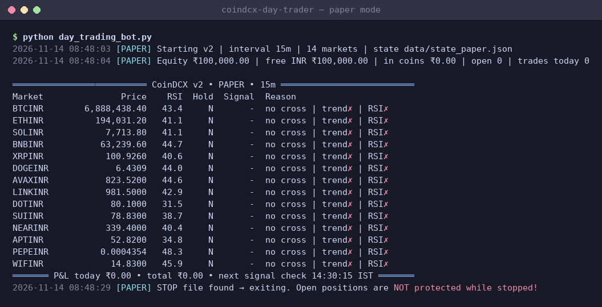
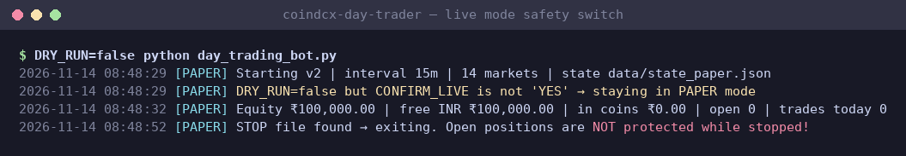
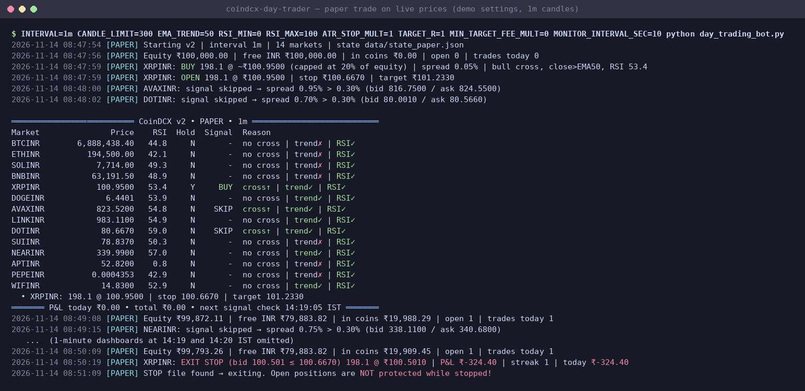
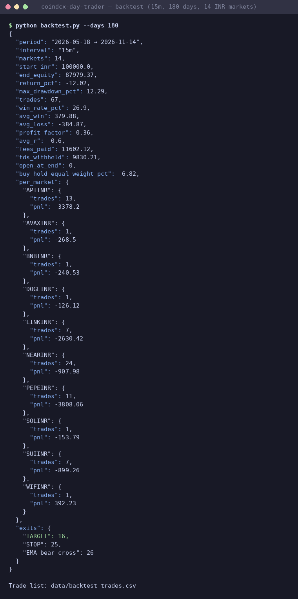
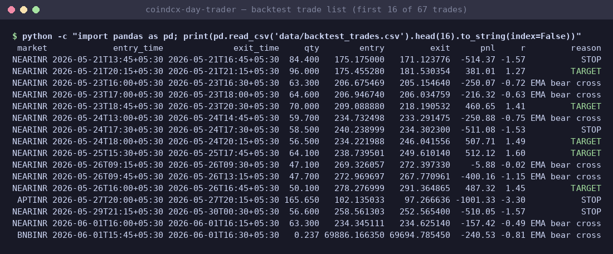
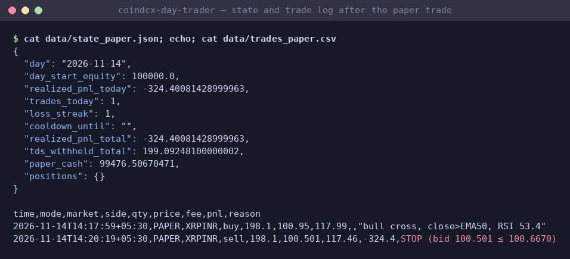
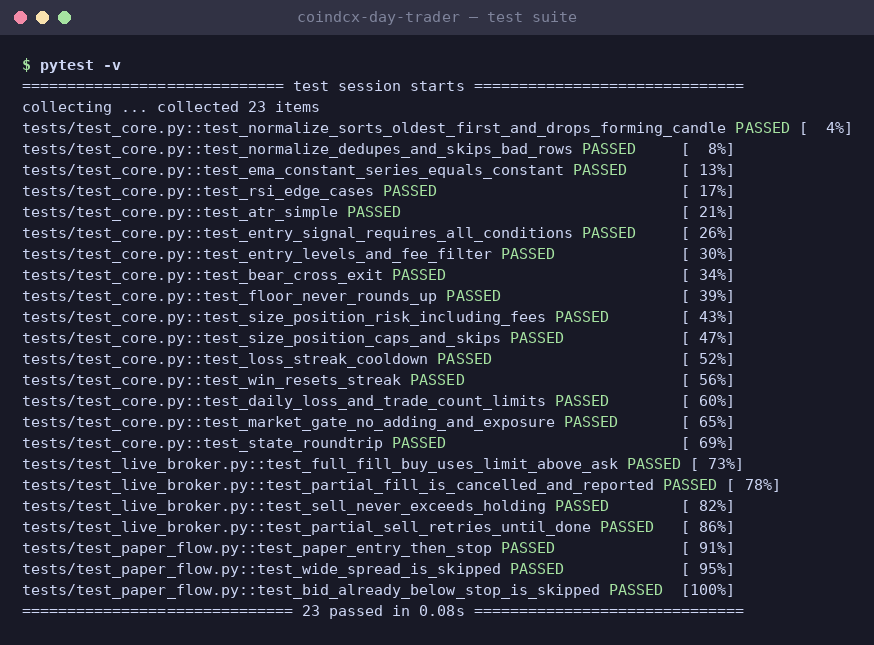

# CoinDCX INR Spot Bot — v2

Python bot for CoinDCX **INR spot** markets: EMA crossover + trend filter + RSI filter,
risk-based position sizing, and bot-managed stop-loss and target.
**Paper trading is the default and needs no API keys.**

> v1 is kept in [`legacy/day_trading_bot_v1.py`](legacy/day_trading_bot_v1.py) and on the
> `backup/v1-legacy` branch. See [CHANGELOG.md](CHANGELOG.md) for what changed and why.

## ⚠️ Read before going live

- **Backtests below lose money after fees.** v2 fixes v1's bugs, but this strategy has no proven edge.
- **Stops are enforced by the bot.** CoinDCX INR markets don't offer stop orders, so the bot checks
  prices every 30 s and exits with a limit order. **If the bot is not running, your positions have no stop.**
- CoinDCX INR spot fees are ~0.50% + 18% GST ≈ **0.59% per side** (≈1.2% per round trip) at the base tier.
  Short timeframes struggle to beat that.
- 1% TDS is deducted on every sell (a tax credit, but it reduces the INR you get back).
- Education only, not financial advice. Check your tax position with a CA.

## Strategy

Evaluated on each **closed** candle (default 15m):

| | Rule |
|---|---|
| **Entry (long only)** | EMA12 crosses above EMA26 **and** close > EMA200 **and** 50 ≤ RSI(14) ≤ 70 |
| **Stop** | entry − 1.5 × ATR(14) |
| **Target** | entry + 2 × (entry − stop) |
| **Early exit** | EMA12 crosses below EMA26 |
| **Fee filter** | skip if the target is < 3× the round-trip fee |

## Risk rules (all configurable)

| Rule | Default |
|---|---|
| Risk per trade (fees included) | 0.5% of equity |
| Max in one coin | 20% of equity |
| Max in all coins | 40% of equity |
| Max open positions | 3 |
| Max new trades per day | 6 |
| Daily loss limit | 2% of start-of-day equity |
| Loss streak | 3 losses in a row → 3 days off |
| Adding to a position | never |
| Bid/ask spread at entry | max 0.30%, and bid must be above the stop |

The bot only manages positions **it opened**. Coins you already hold are left untouched
(they still count towards the 40% exposure cap).

## Backtest (14 INR markets, ₹1,00,000, fees + slippage, run 14 Nov 2026)

| Timeframe | Period | Return | Max DD | Trades | Win rate | Profit factor | Fees paid | Buy & hold |
|---|---|---|---|---|---|---|---|---|
| 15m | May–Nov 2026 (180 d) | **−12.0%** | 12.3% | 67 | 26.9% | 0.36 | ₹11,602 | −6.8% |
| 1h | Nov 2025–Nov 2026 (1 y) | **−42.4%** | 42.5% | 204 | 15.2% | 0.20 | ₹26,036 | −25.4% |
| 1d | Nov 2024–Nov 2026 (2 y) | **−1.1%** | 3.3% | 15 | 33.3% | 0.77 | ₹1,058 | −40.8% |

Fees alone cost about as much as the 15m strategy lost. On daily candles it traded rarely and
avoided most of a falling market, but still did not make money. Run it yourself:

```bash
python backtest.py --days 180                 # 15m, all markets
python backtest.py --days 730 --interval 1d   # daily candles
```

## Screenshots

All screenshots are real terminal output from this version of v2, captured on 14 Nov 2026 against
CoinDCX's live public market data and rendered as images. Paper mode only — no API keys were used,
so `auth_test.py` and live order placement are not shown. Log lines use the machine's clock (the
capture server ran on UTC, so they read 5½ h behind the IST times on the dashboard and trade log;
on an IST machine they match).

### 1. Paper-mode dashboard

`python day_trading_bot.py` with default settings (15m candles, 14 INR markets, ₹1,00,000 paper cash).
Each row shows the last closed candle's price and RSI, whether the bot holds the coin, and which
entry conditions are met (EMA crossover, price above EMA200, RSI 50–70). On this run no market
qualified, so the bot waits for the next candle close (shown at the bottom, in IST).

### 2. Live-mode safety switch

Setting only `DRY_RUN=false` is not enough to trade real money: without `CONFIRM_LIVE=YES` the bot
says so and stays in paper mode.

### 3. A paper trade on live prices: entry → spread checks → stop-loss exit

A full trade cycle from the real bot on live CoinDCX prices. To get a trade within minutes for this
screenshot it ran with **demo settings** (1m candles, EMA50 trend filter, RSI filter off, 1×ATR stop,
1R target) — not the defaults. It shows:
- **XRPINR bought** (spread 0.05%), sized by risk and capped at 20% of equity, with stop and target
  set from the fill price;
- **AVAXINR, DOTINR and NEARINR skipped** because their bid/ask spreads (0.70–0.95%) were wider than
  the 0.30% limit — these show as `SKIP` on the dashboard;
- equity marked to the live bid while the position is open;
- the bot's own stop check **selling XRPINR at the bid** when it fell through the stop, with the
  realised P&L (−₹324.40 including ₹235 of fees) and loss streak.

Two intermediate one-minute dashboards are left out of the image (marked `...`); everything else is
the bot's output as printed.

> This screenshot exists because an earlier test run caught a real problem: DOTINR was bought with a
> 0.57% spread and the bid was already below the stop, so it lost ₹350 in 4 seconds. The spread check
> was added after that run, and all screenshots were re-taken with the fixed version.

### 4. Backtest summary

`python backtest.py --days 180`: 15m candles, 14 markets, 18 May → 14 Nov 2026, with 0.59% fees per
side and 0.1% slippage. Shows return, max drawdown, win rate, profit factor, fees paid, TDS withheld,
P&L per market, exit reasons, and equal-weight buy & hold for comparison.

### 5. Backtest trade list

Every simulated trade is written to `data/backtest_trades.csv` with entry/exit time (IST), size,
prices, P&L in ₹, result in R (multiples of the planned risk) and exit reason. The APTINR row at
−3.30R is a candle that opened far below the stop — the backtest exits at that open, not at the stop.

### 6. State and trade log files

After the paper trade in screenshot 3: `data/state_paper.json` keeps cash, P&L, the loss streak,
cooldown date and open positions across restarts, and `data/trades_paper.csv` logs every buy and sell
(times in IST). Paper cash is ₹99,476.51, not ₹99,675.60, because 1% TDS (₹199.09) was withheld on
the sell — it is a tax credit, so it is tracked separately from P&L.

### 7. Test suite

`pytest -v`: 23 tests covering candle ordering, indicators, signals, sizing, risk gates, an end-to-end
paper trade, the spread checks, and live order handling (partial fills, cancel on timeout, never
selling more than held) against a fake exchange.

## Setup

```bash
python3 -m venv venv && source venv/bin/activate
pip install -r requirements.txt
python day_trading_bot.py          # PAPER mode, ₹1,00,000 of paper cash
touch STOP                         # stop gracefully
```

Files are written to `data/`: `state_paper.json` (positions, P&L, streaks), `trades_paper.csv`, `bot.log`.

### Settings

Every value in [`config.py`](config.py) can be overridden with an environment variable, e.g.

```bash
export INTERVAL=1h RISK_PER_TRADE_PCT=0.25 WATCHLIST=BTCINR,ETHINR,SOLINR
```

### Going live (only after paper trading)

1. Create an API key on CoinDCX with **trading only — withdrawals disabled**, and **bind it to your server's IP**.
2. Test it: `export COINDCX_API_KEY=... COINDCX_API_SECRET=...` then `python auth_test.py`
3. Start live mode (two switches, on purpose):
   ```bash
   export DRY_RUN=false CONFIRM_LIVE=YES
   python day_trading_bot.py
   ```
4. Start with 1–2 markets and a small balance. Keep it running under systemd or tmux.

### systemd (run as a normal user, not root)

```ini
# /etc/systemd/system/coindcx-bot.service
[Unit]
Description=CoinDCX INR Bot v2
After=network-online.target

[Service]
User=trader
WorkingDirectory=/home/trader/coindcx-day-trader
EnvironmentFile=/etc/coindcx-bot.env      # chmod 600, owned by trader
ExecStart=/home/trader/coindcx-day-trader/venv/bin/python day_trading_bot.py
Restart=always
RestartSec=15

[Install]
WantedBy=multi-user.target
```

## Tests

```bash
pip install -r requirements-dev.txt
pytest -q
```

23 tests: candle ordering, indicators, signals, sizing, risk gates, spread checks, a paper trade end to
end, and the live order logic (partial fills, cancel on timeout, never selling more than held) against a
fake exchange.

## Files

| File | Purpose |
|---|---|
| `day_trading_bot.py` | Main loop: signals on candle close, stop/target checks every 30 s |
| `strategy.py` | Candles, EMA / RSI / ATR, entry and exit rules (shared with backtest) |
| `risk.py` | Position sizing, risk gates, persistent state |
| `broker.py` | Paper and live execution (limit orders, partial fills, retries) |
| `coindcx_client.py` | CoinDCX REST client |
| `backtest.py` | Portfolio backtest on CoinDCX history |
| `auth_test.py` | Checks your API key (masked output) |
| `legacy/` | v1, unchanged |
